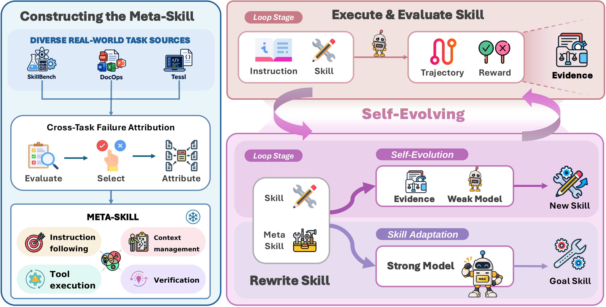

<div align="center">

# Evolving to Match Capabilities

<h3 align="center">Improving Harness Self-Evolution via Skill Adaptation</h3>

<p align="center" style="line-height:1.5;margin:0.4em 0 0.3em;">
<span style="white-space:nowrap;"><b><a href="https://zhihaoyang30.github.io/">Zhihao Yang</a></b><sup>1,7,*</sup></span>,
<span style="white-space:nowrap;"><b><a href="https://haojinw0027.github.io/">Haojin Wang</a></b><sup>2,*</sup></span>,
<span style="white-space:nowrap;"><b><a href="https://chtholly17.github.io/">Juncheng Wu</a></b><sup>3,*</sup></span>,
<span style="white-space:nowrap;"><a href="https://itheresaapocalypse.github.io/">Kuan Zhang</a><sup>4</sup></span>,
<span style="white-space:nowrap;"><a href="https://scholar.google.com/citations?user=JWxSJVgAAAAJ&hl=zh-CN">Yukun Chen</a><sup>1</sup></span>,
<span style="white-space:nowrap;"><a href="https://rainbowluocs.github.io/">Run Luo</a><sup>5</sup></span>,
<span style="white-space:nowrap;"><a href="https://yaojie.lu/">Yaojie Lu</a><sup>6</sup></span>,
<span style="white-space:nowrap;"><a href="https://yuyinzhou.github.io/">Yuyin Zhou</a><sup>3</sup></span>,
<span style="white-space:nowrap;"><b><a href="https://openreview.net/profile?id=~Lu_Wang26">Lu Wang</a></b><sup>4,†</sup></span>,
<span style="white-space:nowrap;"><b><a href="https://scholar.google.com/citations?user=pA88bm4AAAAJ&hl=en">Xianpei Han</a></b><sup>6,†</sup></span>
</p>

<p align="center" style="font-size:0.85em;line-height:1.5;margin:0 0 0.6em;">
<span style="white-space:nowrap;"><sup>1</sup>University of Chinese Academy of Sciences</span> &nbsp;
<span style="white-space:nowrap;"><sup>2</sup>Independent Researcher</span> &nbsp;
<span style="white-space:nowrap;"><sup>3</sup>University of California, Santa Cruz</span> &nbsp;
<span style="white-space:nowrap;"><sup>4</sup>Tsinghua University</span> &nbsp;
<span style="white-space:nowrap;"><sup>5</sup>National University of Singapore</span> &nbsp;
<span style="white-space:nowrap;"><sup>6</sup>Chinese Information Processing Laboratory, Institute of Software, Chinese Academy of Sciences</span> &nbsp;
<span style="white-space:nowrap;"><sup>7</sup>School of Advanced Interdisciplinary Sciences, University of Chinese Academy of Sciences</span><br>
<span style="white-space:nowrap;"><sup>*</sup>Equal contribution</span> &nbsp;
<span style="white-space:nowrap;"><sup>†</sup>Corresponding authors</span>
</p>

<p align="center">
  <a href="https://arxiv.org/abs/2610.33024"></a>
  <a href="https://huggingface.co/papers/2610.33024"></a>
  <a href="https://zhihaoyang30.github.io/skill-adaptation/"></a>
  <a href="https://zhihaoyang30.github.io/skill-adaptation/paper.pdf"></a>
  <a href="https://github.com/zhihaoyang30/skill-adaptation-code"></a>
</p>

<h3 align="center">
  If you find this work useful, please upvote our <a href="https://huggingface.co/papers/2610.33024">Daily Paper</a> on Hugging Face.<br>
  Thank you for your support!
</h3>

</div>

---

> **TL;DR** — The same agent skill can lift a strong model while sinking a weaker one. We diagnose why, distill the diagnosis into a fixed **meta-skill** that rewrites skills to match the executor, and show it improves both one-shot **skill adaptation** and five-round **harness self-evolution** — across all seven executors.

This repository hosts the interactive project page. Reproduction code is in a separate repository: [zhihaoyang30/skill-adaptation-code](https://github.com/zhihaoyang30/skill-adaptation-code).

## The Problem

Across **seven models** spanning three capability tiers, well-crafted skills improve
GPT-5.6-luna by **+31.1 score points**, yet reduce Gemma-4-E4B's score by **−8.8 points**.

In **86% of failed weak-model runs, the violated requirement is already stated in the skill** —
effective guidance depends on *how* instructions are organized and presented, not just what they say.

## The Method

We analyze recurring failures in **instruction following**, **context management**, **tool
execution**, and **verification**, and distill these findings into a **meta-skill** — a fixed
rewriting protocol for adapting skills to the executor. We then integrate this protocol into
**harness self-evolution**, where agents iteratively revise their skills from execution
trajectories and verifier feedback.



## Key Results

Evaluated on **103 skill-sensitive task–skill pairs**, screened from 607 pairs across
**SkillsBench · DocOps · Tessl**:

| Setting | Result |
|---|---|
| **One-shot skill adaptation** (Kimi-K3 rewrites, no execution evidence) | **+5.1 ~ +14.1** points over the original skills, for all three weak executors |
| **Five-round self-evolution** (each model rewrites its own skill) | **+2.0 ~ +5.1** points over the same loop without the meta-skill, across **all seven executors** |

**Takeaways**

1. Through skill adaptation, a capable rewriter turns human-crafted skills that weak models could not use into skills they can use effectively.
2. Distilling executor failure modes into a meta-skill improves skill adaptation by providing explicit guidance on what to revise and how.
3. Given evidence of failure, weak models can use the meta-skill to self-evolve better skills, ending above self-evolution without it.

## Explore

- **Interactive project page**: https://zhihaoyang30.github.io/skill-adaptation/
- **Daily Paper**: https://huggingface.co/papers/2610.33024
- **Paper**: [paper.pdf](https://zhihaoyang30.github.io/skill-adaptation/paper.pdf)
- **Code**: [zhihaoyang30/skill-adaptation-code](https://github.com/zhihaoyang30/skill-adaptation-code)
- **arXiv**: https://arxiv.org/abs/2610.33024

## Citation

```bibtex
@misc{yang2026evolvingmatchcapabilitiesimproving,
      title={Evolving to Match Capabilities: Improving Harness Self-Evolution via Skill Adaptation},
      author={Zhihao Yang and Haojin Wang and Juncheng Wu and Kuan Zhang and Yukun Chen and Run Luo and Yaojie Lu and Yuyin Zhou and Lu Wang and Xianpei Han},
      year={2026},
      eprint={2610.33024},
      archivePrefix={arXiv},
      primaryClass={cs.LG},
      url={https://arxiv.org/abs/2610.33024},
}
```
